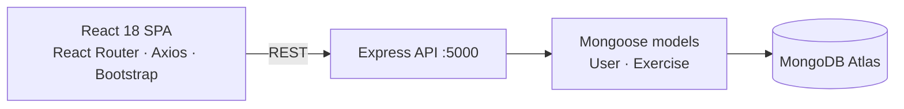

<div align="center">

# 🏋️ Fitness Tracker

**A full-stack MERN app for logging workouts: create users, record exercises with duration and date, and edit or delete entries.**


</div>

---

## ✦ Features

- **Users:** create a user with a unique username.
- **Exercise log:** add exercises with a description, duration (minutes) and date, using a date picker.
- **Full CRUD:** list, view, edit and delete exercises.
- **REST API:** Express + Mongoose with validation and timestamps on every record.
- **SPA:** React Router pages styled with Bootstrap, calling the API with Axios.

## ✦ Architecture



## ✦ API

| Method | Endpoint | Description |
|---|---|---|
| `GET` | `/users` | List users |
| `POST` | `/users/add` | Create a user: `{ username }` |
| `GET` | `/exercises` | List exercises |
| `POST` | `/exercises/add` | Create an exercise: `{ username, description, duration, date }` |
| `GET` | `/exercises/:id` | Get one exercise |
| `DELETE` | `/exercises/:id` | Delete an exercise |
| `POST` | `/exercises/update/:id` | Update an exercise |

## ✦ Getting started

Run the API and the React app in two terminals.

**API** (http://localhost:5000). Create `backend/.env` with `MONGODB_URI=your_mongodb_connection_string`, then:

```bash
cd backend
npm install
npm start
```

**Frontend** (http://localhost:3000):

```bash
npm install
npm start
```

## ✦ Project structure

```
├── backend/
│   ├── server.js              # Express app, routes, DB connection
│   ├── db/conn.js
│   ├── models/                # user.js, exercise.js (Mongoose schemas)
│   ├── controllers/           # request handlers
│   └── routes/                # /users, /exercises
└── src/
    ├── App.js                 # React Router setup
    └── components/            # navbar, exercises list, create / edit exercise, create user
```

---

<div align="center"><sub>Built by <a href="https://github.com/RayaanQ">Rayaan Quraishi</a> · <a href="https://rayaanq.github.io/Portfolio/">Portfolio</a> · <a href="https://www.linkedin.com/in/rayaan-quraishi">LinkedIn</a></sub></div>
